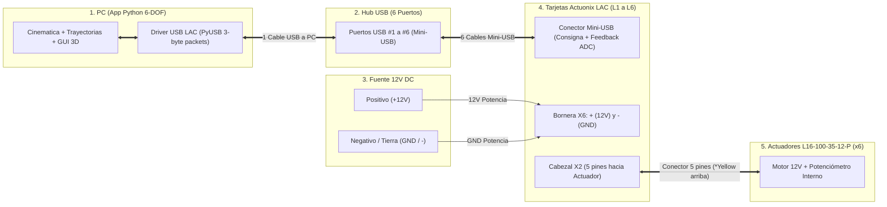

# Manual de Conexión Física e Integración
## Plataforma Gough-Stewart 6-DOF (Control Directo por USB: Hub 6 Puertos + 6x Actuonix LAC + L16-P)

---

## 1. Lista de Componentes del Sistema

* **PC de Control:** Aplicación Python (`main.py`) con comunicación USB directa de 10 bits (`0..1023`).
* **Hub USB (1x):** Hub USB de 6 o más puertos (recomendado con alimentación externa) conectado a un puerto USB de la PC.
* **Cables USB (6x):** 6 cables **USB-A a Mini-USB** (uno para cada tarjeta LAC).
* **Tarjetas de Control (6x):** Actuonix **LAC** (Linear Actuator Control Board, `VID=0x04D8`, `PID=0xFC5F`).
* **Actuadores Lineales (6x):** Actuonix **L16-100-35-12-P** (100 mm de carrera, relación 35:1, 12 V DC, con retroalimentación interna por potenciómetro).
* **Fuente de Alimentación:** Fuente de **12 V DC** conectada únicamente a las borneras de potencia `X6.+` y `X6.-` de las 6 tarjetas LAC.

> [!NOTE]
> **Eliminación de hardware intermedio:** En esta arquitectura ya **no se utilizan** el Arduino GIGA R1, el GIGA Display Shield ni el módulo ADS1256. Tampoco se cablean señales PWM (`X6.VC`) ni salidas analógicas de potenciómetro (`X4.P`) hacia el exterior; tanto la consigna como la retroalimentación de posición viajan digitalmente por el cable Mini-USB de cada tarjeta LAC.

---

## 2. Diagrama General de Bloques

---

## 3. Paso 1: Conexión de Alimentación (`12V`) y Actuador en cada Tarjeta LAC

Para cada una de las 6 tarjetas Actuonix LAC (`L1` a `L6`):

1. **Alimentación de potencia (`X6.+` y `X6.-`):**
   * Conecta el positivo **`+12V`** de tu fuente al tornillo **`+` (Pin 2 de la bornera X6)**.
   * Conecta el negativo **`GND (-)`** de tu fuente al tornillo **`-` (Pin 1 de la bornera X6)**.
   * Deja libres los tornillos `VC`, `IC` y `RC` de `X6` (el comando USB `0x20 SET_POSITION` deshabilita automáticamente las entradas analógicas/RC).
2. **Conexión del actuador `L16-100-35-12-P` en `X2`:**
   * Enchufa el conector hembra de 5 pines del actuador directamente en el cabezal **`X2`** de su tarjeta LAC.
   * **Orientación obligatoria:** El cable **Amarillo** del actuador debe quedar hacia arriba, alineado con la marca **`*Yellow`** impresa en la placa LAC.
   * Deja totalmente libre la bornera `X4` (la tarjeta LAC lee el potenciómetro internamente a través de `X2` y entrega el valor digital de 10 bits por USB).
3. **Conexión Mini-USB:**
   * Conecta cada tarjeta LAC a un puerto del Hub USB mediante su cable Mini-USB.

---

## 4. Paso 2: Asignación Única de ID (`1` a `6`) para cada Tarjeta LAC

Dado que Windows puede enumerar los puertos de un Hub USB en distinto orden al reiniciar la PC, las tarjetas LAC disponen del comando **`0x50 SET_SERIAL_NUM`** (guardado en su memoria EEPROM) y **`0x51 GET_SERIAL_NUM`** (página 10 del datasheet):

1. Cuando recibas el Hub y los cables Mini-USB, abre la aplicación (`python main.py`) y haz clic en el botón superior **`⚙ CONFIG USB`**.
2. Para identificarlas fácilmente la primera vez, puedes conectar las tarjetas **una por una** al Hub USB (o conectar las 6 e ir probando):
   * Haz clic en **`↻ Escanear USB`** y luego en **`CONECTAR`**.
   * En la sección **"2. Identificación de Tarjetas en el Hub (0x50 SET_SERIAL_NUM)"**, selecciona la tarjeta detectada, elige a qué actuador físico corresponde (**`Actuador L1 (Serial ID = 1)`** hasta **`Actuador L6 (Serial ID = 6)`**) y presiona **`Grabar ID (0x50)`**.
3. ¡Listo! Ese número (`1` a `6`) queda guardado permanentemente en la EEPROM de cada tarjeta LAC. A partir de ese momento, **no importa en qué puerto del Hub USB enchufes cada cable**: al abrir la app, el sistema interroga las 6 tarjetas con `0x51 GET_SERIAL_NUM` y asigna automáticamente cada una a su eje `L1..L6`.

---

## 5. Funcionamiento Automático al Iniciar la Aplicación

Cada vez que ejecutas la aplicación:
1. **Detección e Identificación (`0x51 GET_SERIAL_NUM`):** Escanea el Hub USB buscando dispositivos `VID=0x04D8, PID=0xFC5F` y asocia cada tarjeta a `L1..L6`.
2. **Carga de Configuración (`0x01` a `0x0F`):** Sube automáticamente a las 6 tarjetas los parámetros configurados en `config/parameters.json` (`Accuracy`, `Retract Limit`, `Extend Limit`, ganancias `Kp`/`Kd`, `PWM Max/Min`, `Stall Time`, `Movement Threshold`, `Average ADC`).
3. **Lectura Inicial (`0x10 GET_FEEDBACK`):** Consulta la posición real actual (`0..1023`) de los 6 actuadores y actualiza las barras y gráficas de telemetría.
4. **Control y Retroalimentación en Tiempo Real (`0x20 SET_POSITION`):** En cada ciclo de movimiento, envía el paquete de 3 bytes `[0x20, low, high]` (`0..1023`) a cada LAC y recibe en la respuesta inmediata de 3 bytes la lectura actual del ADC interno de la tarjeta.
