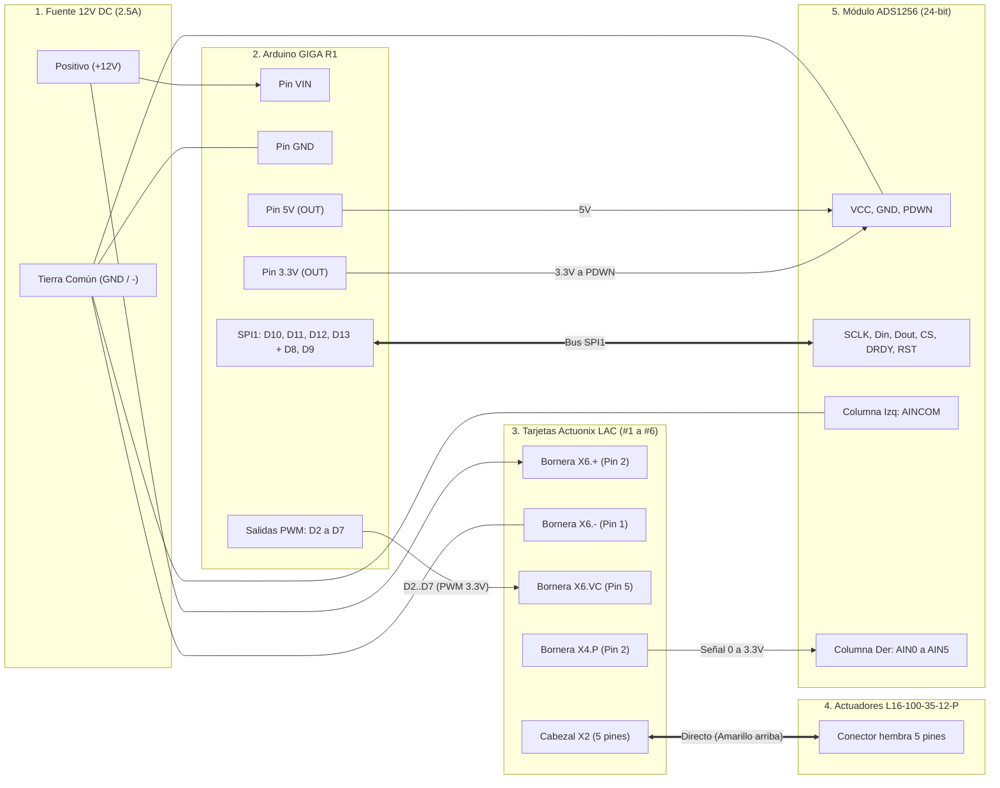

# Manual de Conexión Física e Integración
## Plataforma Gough-Stewart 6-DOF (Arduino GIGA R1 + Actuonix LAC + ADS1256 + L16-P)

---

## 1. Lista de Componentes del Sistema

* **Controlador Principal:** Arduino GIGA R1 WiFi (lógica de 3.3 V) + GIGA Display Shield.
* **Actuadores Lineales (6x):** Actuonix **L16-100-35-12-P** (100 mm de carrera, relación 35:1, 12 V DC, con retroalimentación por potenciómetro).
* **Tarjetas de Control (6x):** Actuonix **LAC** (Linear Actuator Control Board).
* **Convertidor Analógico-Digital (1x):** Módulo **ADS1256** de 24 bits y 8 canales (placa verde).
* **Fuente de Alimentación:** Fuente de **12 V DC / 2.5 A** (con `GND` común para todo el sistema).

---

## 2. Diagrama General de Bloques



---

## 3. Paso 1: Alimentación y Tierra Común (`GND`)

Toda la electrónica debe compartir la misma referencia de tierra (`GND`):

| Origen (Fuente / Arduino) | Destino | Cable / Terminal | Nota de Seguridad |
| :--- | :--- | :--- | :--- |
| **Fuente `+12V`** | **Arduino GIGA** | Pin **`VIN`** | Alimenta la Arduino GIGA. |
| **Fuente `+12V`** | **Tarjetas LAC (#1 a #6)** | Bornera **`X6.+`** (Pin 2 de X6) | Alimentación de potencia para los motores de 12 V. |
| **Fuente `GND` (`-`)** | **Arduino GIGA** | Pin **`GND`** | Tierra principal de referencia. |
| **Fuente `GND` (`-`)** | **Tarjetas LAC (#1 a #6)** | Bornera **`X6.-`** (Pin 1 de X6) | Tierra de potencia y señal de cada tarjeta LAC. |
| **Arduino `GND`** | **Módulo ADS1256** | Pin **`GND`** (lado izquierdo) | Tierra de alimentación del módulo ADS1256. |
| **Arduino `GND`** | **Módulo ADS1256** | Pin **`AINCOM`** (columna izquierda de pines amarillos derechos) | **¡Indispensable!** Referencia de 0 V para los canales `AIN0–AIN7`. |

---

## 4. Paso 2: Conexión del Actuador `L16-100-35-12-P` a la Tarjeta `LAC`

En la tarjeta Actuonix LAC, el conector blanco/negro de 5 pines **`X2`** y la bornera verde de tornillos **`X4`** están unidos internamente en paralelo sobre la placa.

1. **Conectar el actuador L16-100-35-12-P directo en `X2`:**
   * Enchufa el conector de 5 pines del actuador directamente en el cabezal **`X2`** de la LAC.
   * **Orientación obligatoria:** El cable **Amarillo** del actuador debe quedar hacia arriba, alineado con la marca **`*Yellow`** impresa en la placa LAC.
2. **Salida de lectura de posición desde `X4.P`:**
   * De la bornera verde **`X4`**, **solo vas a utilizar el tornillo `P` (Pin 2 de X4)**.
   * Internamente, la tarjeta LAC ya alimenta el potenciómetro del actuador con 3.3 V a través de `X2`, y por el tornillo **`X4.P`** sale directamente el voltaje de posición (**0 V a 3.3 V**) hacia el ADS1256.
   * *(No necesitas conectar nada en `X4.P+`, `X4.M+`, `X4.M-` ni `X4.P-` porque ya van por el conector `X2`).*

---

## 5. Paso 3: Conexión de los 6 Ejes (`Arduino GIGA` $\rightarrow$ `LAC` $\rightarrow$ `ADS1256`)

> [!IMPORTANT]
> **Atención en el cabezal amarillo derecho del ADS1256 ($2 \times 8$ pines):**
> * **Columna Izquierda (`AINCOM`):** Los 8 pines de la columna izquierda están unidos entre sí. Conecta **1 solo cable desde `GND` de la Arduino** a cualquiera de los pines de esta columna izquierda.
> * **Columna Derecha (`AIN0` a `AIN7`):** Aquí entran los cables que vienen de **`X4.P`** de cada tarjeta LAC (`AIN0` es el pin de hasta abajo y `AIN7` el de hasta arriba).

| Eje | Salida PWM Arduino GIGA | Entrada Control en LAC (`X6`) | Salida Posición en LAC (`X4`) | Entrada Analógica en ADS1256 *(Columna Derecha)* | Respaldo Analógico GIGA *(Opcional)* |
| :---: | :---: | :---: | :---: | :---: | :---: |
| **Eje 1 (`L1`)** | Pin **`D2`** | `LAC #1` $\rightarrow$ Tornillo **`X6.VC`** | `LAC #1` $\rightarrow$ Tornillo **`X4.P`** | **`AIN0`** *(Columna Derecha, abajo)* | `A0` |
| **Eje 2 (`L2`)** | Pin **`D3`** | `LAC #2` $\rightarrow$ Tornillo **`X6.VC`** | `LAC #2` $\rightarrow$ Tornillo **`X4.P`** | **`AIN1`** *(Columna Derecha)* | `A1` |
| **Eje 3 (`L3`)** | Pin **`D4`** | `LAC #3` $\rightarrow$ Tornillo **`X6.VC`** | `LAC #3` $\rightarrow$ Tornillo **`X4.P`** | **`AIN2`** *(Columna Derecha)* | `A2` |
| **Eje 4 (`L4`)** | Pin **`D5`** | `LAC #4` $\rightarrow$ Tornillo **`X6.VC`** | `LAC #4` $\rightarrow$ Tornillo **`X4.P`** | **`AIN3`** *(Columna Derecha)* | `A3` |
| **Eje 5 (`L5`)** | Pin **`D6`** | `LAC #5` $\rightarrow$ Tornillo **`X6.VC`** | `LAC #5` $\rightarrow$ Tornillo **`X4.P`** | **`AIN4`** *(Columna Derecha)* | `A4` |
| **Eje 6 (`L6`)** | Pin **`D7`** | `LAC #6` $\rightarrow$ Tornillo **`X6.VC`** | `LAC #6` $\rightarrow$ Tornillo **`X4.P`** | **`AIN5`** *(Columna Derecha)* | `A5` |

---

## 6. Paso 4: Conexión Digital y Alimentación `ADS1256` $\leftrightarrow$ `Arduino GIGA R1`

Conecta los 10 pines del cabezal amarillo izquierdo del módulo **ADS1256** (de arriba hacia abajo según la serigrafía de la placa) hacia el **Arduino GIGA R1**:

| Orden (Arriba $\rightarrow$ Abajo) | Pin en ADS1256 (Lado Izquierdo) | Pin en Arduino GIGA R1 | Función y Observaciones |
| :---: | :--- | :--- | :--- |
| **1** | **`GND`** | **`GND`** | Tierra común del sistema. |
| **2** | **`VCC`** | **`5V`** | Alimentación de 5 V para el regulador y referencia `REF03` (2.5 V) del ADS1256. |
| **3** | **`NC`** | *Sin conectar* | Dejar libre. |
| **4** | **`RST`** | **`D8`** | Reset físico del ADS1256 controlado por el Arduino. |
| **5** | **`CS`** | **`D10`** (`SPI5_NSS`) | Selección de chip SPI (Chip Select). |
| **6** | **`DRDY`** | **`D9`** | Señal *Data Ready* (avisa al Arduino cuando termina cada conversión). |
| **7** | **`Dout`** | **`D12`** (`SPI5_CIPO` / `MISO`) | Salida de datos del ADS1256 hacia el Arduino. |
| **8** | **`Din`** | **`D11`** (`SPI5_COPI` / `MOSI`) | Entrada de comandos del Arduino hacia el ADS1256. |
| **9** | **`SCLK`** | **`D13`** (`SPI5_SCK`) | Reloj de comunicación SPI (`SPI1` en código de Arduino GIGA). |
| **10** | **`PDWN`** | **`3.3V`** (Pin `3V3`) | **¡MUY IMPORTANTE!** Debe ir conectado a **3.3V**; si se deja desconectado, el ADS1256 permanece apagado. |

---

## 7. Lista de Verificación Rápida antes de Encender (Checklist)

- [ ] **1. Cabezal `2.5V / GND` del ADS1256 (abajo a la derecha junto al chip `REF03`):** Verifica que **NO tenga ningún jumper puesto** haciendo puente entre `2.5V` y `GND`. Esos dos pines deben estar abiertos (sin puente).
- [ ] **2. Pin `PDWN` del ADS1256:** Verifica que tenga cable hacia el pin **`3.3V`** del Arduino GIGA.
- [ ] **3. Pin `AINCOM` del ADS1256:** Verifica que al menos un pin de la **columna izquierda** del cabezal `AIN` esté conectado a **`GND`** de la Arduino.
- [ ] **4. Cables `X4.P` de las LAC:** Verifica que entren en la **columna derecha** (`AIN0` a `AIN5`) del cabezal `AIN`.
- [ ] **5. Potenciómetros azules de la LAC:**
  - `Speed` (Velocidad): Girado a la derecha (sentido horario = máxima velocidad).
  - `Retract Limit` y `Extend Limit` (abajo junto al USB): Girados completamente a la derecha (sentido horario = 100% de carrera permitida).
  - `Accuracy`: Girado a la derecha y regresado ~1/8 de vuelta si se escucha vibración. *(Recuerda que si mueves un potenciómetro azul de la LAC, debes apagar y volver a encender los 12 V de la LAC para que tome el cambio).*

---

## 8. Pasos en Casa para Actualizar Software y Firmware

1. **Actualizar el repositorio en la PC de tu casa:**
   Abre una terminal en la carpeta del proyecto y ejecuta:
   ```powershell
   git pull origin main
   ```
2. **Subir el nuevo Sketch al Arduino GIGA R1:**
   * Abre en Arduino IDE el archivo del proyecto:
     `firmware/gough_stewart_giga_ads1256/gough_stewart_giga_ads1256.ino`
   * Compila y súbelo al **Arduino GIGA R1**.
   * En la parte inferior de la pantalla del Arduino GIGA verás:
     * `ADC: ADS1256 24-bit SPI1` (si el ADS1256 respondió correctamente por SPI).
     * `ADC: INTERNO A0-A5` (si aún no conectas el ADS1256, usando `A0–A5` automáticamente como respaldo).
3. **Probar en la Interfaz Gráfica (`python main.py`):**
   * Haz clic en **⚙ CONFIG**, selecciona el puerto COM del Arduino GIGA a `115200` baudios y presiona **CONECTAR**.
   * El indicador superior pasará a **CONECTADO (Verde)**, enviará automáticamente `adsinit` y mantendrá viva la conexión con `ping` cada 2.5 segundos.
   * Ve a la pestaña **Actuadores (L1 - L6)** (ahora organizada en cuadrícula `2×3` sin barras de scroll): mueve el slider de `L1` y observa cómo la barra verde **Real** sigue al **Setpoint (SP)**.
